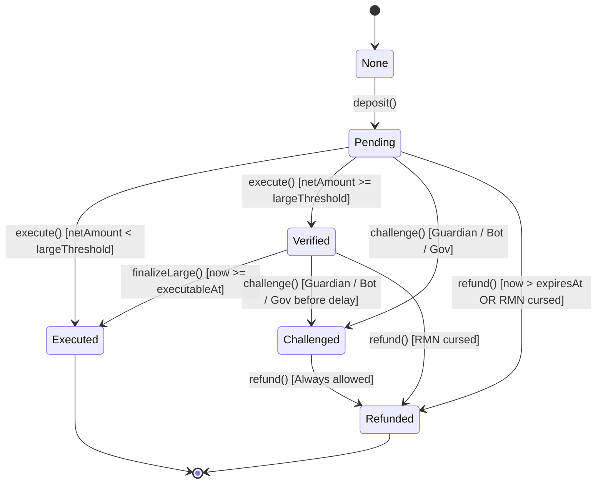
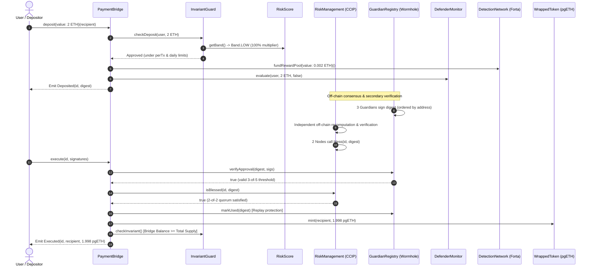

# PayGuard System Architecture

## 1. System Overview

PayGuard is a layered payment-integrity bridge system that bridges native ETH to wrapped pgETH tokens. It enforces end-to-end security across three crucial transaction lifecycle points:

1. **Before / at Execution:** On-chain invariants and dynamic risk-weighted limits (`InvariantGuard`).
2. **At Consensus:** Distributed multi-signature approvals (`GuardianRegistry`) combined with independent secondary verification and cursing (`RiskManagement`).
3. **After Deployment:** Automated rule monitoring, incident response and timelocked multi-sig governance (`DefenderMonitor`), decentralized detection bot alerting and slashing (`DetectionNetwork`), and real-time risk scoring (`RiskScore`).

---

## 2. Component Diagram

```
                             +------------------------+
                             |     PaymentBridge      |
                             | (Core Lock & Mint Hub) |
                             +-----------+------------+
                                         |
     +-----------------------------------+-----------------------------------+
     |                                   |                                   |
     v                                   v                                   v
+------------------+           +--------------------+           +----------------------+
|  InvariantGuard  |           |  GuardianRegistry  |           |   RiskManagement     |
| (Solvency Invar, |           | (Wormhole 3-of-5   |           | (CCIP Secondary RMN, |
|  Dynamic Limits) |           |  Sorted Signatures)|           |  2-of-2 Bless/Curse) |
+--------+---------+           +---------+----------+           +----------+-----------+
         |                               |                                 |
         | (Multipliers)                 | (Verification)                  | (Penalties)
         v                               v                                 v
+------------------+           +--------------------+           +----------------------+
|    RiskScore     |<----------|   DefenderMonitor  |<----------|   DetectionNetwork   |
| (Skynet Dynamic  | (Penalties| (OpenZeppelin Rules| (Alerts & | (Forta Staked Bots,  |
|  Score 0 - 100)  |  -5, -15) |  Pause, Multi-Sig) |  Rewards) |  Slash, Challenges)  |
+------------------+           +--------------------+           +----------------------+
```

---

## 3. Transfer Lifecycle State Machine



---

## 4. End-to-End Transfer Sequence Flow



---

## 5. Security Interconnection & Feedback Loop

The key contribution of PayGuard is the bidirectional closed-loop connection between monitoring and protocol execution:

```
[ Security Incident Detected ] 
          │
          ├──> DetectionNetwork valid alert (Severity 1-3)
          ├──> DefenderMonitor rule trip (VELOCITY, RAPID_REDEEM, etc.)
          └──> RiskManagement emergency curse
          │
          ▼
   [ RiskScore.reduce(points) ]
          │
          ▼
   [ RiskScore.getBand() ]
   ├── LOW      (80-100) -> 100% Limits
   ├── MEDIUM   (50-79)  -> 50% Limits
   ├── HIGH     (20-49)  -> 10% Limits
   └── CRITICAL (< 20)   -> 0% Limits (Deposits Halted)
          │
          ▼
[ InvariantGuard.effectivePerTxLimit() auto-shrinks on-chain ]
```
